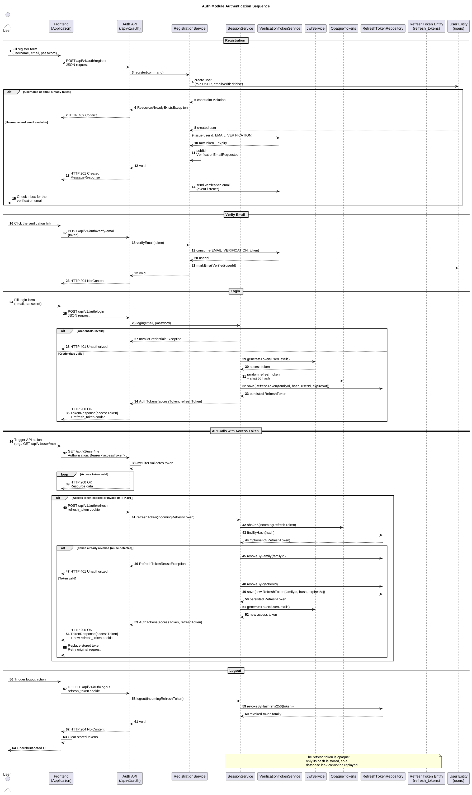

# Frontend Integration

## What the User Can Do

| User Action | API Endpoint | Required Input |
|-------------|--------------|----------------|
| Register new account | `POST /api/v1/auth/register` | username, email, password, timezone |
| Verify email | `POST /api/v1/auth/verify-email` | verification token from email |
| Resend verification email | `POST /api/v1/auth/resend-verification` | email address |
| Request password reset email | `POST /api/v1/auth/forgot-password` | email address |
| Reset password | `POST /api/v1/auth/reset-password` | reset token from email, new password |
| Login | `POST /api/v1/auth/login` | email, password |
| Refresh access token | `POST /api/v1/auth/refresh` | refresh token cookie |
| Logout (revoke tokens) | `DELETE /api/v1/auth/logout` | refresh token cookie |
| Change password | `PATCH /api/v1/auth/password` | old password, new password |

## Resources and Display

### User Account
- Display username and email after registration/login
- Access token used for authenticated API calls (`Authorization: Bearer <accessToken>`)
- Refresh token is delivered as an `HttpOnly` cookie — the frontend never reads it

### Authentication State
- Track whether the user is logged in (has a valid access token)
- Track whether the email is verified; an unverified account cannot log in
- Access token has short lifespan — refresh via the refresh token cookie before expiry
- On token expiry, attempt silent refresh using the cookie
- On refresh failure, clear the session and prompt the user to log in again

## Forms and Fields

### Register Form
| Field | Required | Validation | Notes |
|-------|----------|------------|-------|
| username | Yes | Not blank, 3–30 chars | Must be unique across system |
| email | Yes | Valid email format | Must be unique across system |
| password | Yes | Min 8 chars, max 72 | Strength validation recommended |
| timezone | Yes | Valid IANA timezone | Used by stats and progress calculations; prefill from the browser |

### Login Form
| Field | Required | Validation | Notes |
|-------|----------|------------|-------|
| email | Yes | Valid email format | |
| password | Yes | Not blank | |

### Email Verification Form
| Field | Required | Validation | Notes |
|-------|----------|------------|-------|
| token | Yes | Not blank | Usually pre-filled from a `?token=` query parameter in the emailed link |

### Change Password Form
| Field | Required | Validation | Notes |
|-------|----------|------------|-------|
| oldPassword | Yes | Not blank | |
| newPassword | Yes | Min 8 chars | Must differ from the current password |

### Password Reset Form
| Field | Required | Validation | Notes |
|-------|----------|------------|-------|
| email | Yes | Valid email format | Sent to `POST /api/v1/auth/forgot-password` |
| token | Yes | Not blank | Usually pre-filled from a `?token=` query parameter in the emailed link |
| newPassword | Yes | Min 8 chars | Must differ from the current password |

## Endpoint Mapping to User Actions

### Registration
1. User fills the register form and submits
2. `POST /api/v1/auth/register` → `201` with `{ "message": "Please check your email to verify your account" }`
3. **No tokens are returned.** The account exists but is unverified
4. Show a "check your email" screen with a resend option
5. Navigate to login only after the email is verified

### Email Verification
1. The email contains a link that points to the frontend with the token (for example `https://app.example.com/verify-email?token=...`)
2. Read the token from the query string and submit `POST /api/v1/auth/verify-email`
3. On success, the API returns an access token in the body and sets the `refresh_token` cookie
4. Store the access token and treat the user as authenticated
5. On `400`, show "This verification link is invalid or has expired" and offer a resend button

### Resend Verification Email
1. User requests a resend from the "check your email" screen
2. `POST /api/v1/auth/resend-verification` with the email
3. Always show "If that email exists, we sent a new verification link" — the response is identical in every case
4. Never reveal whether the address is registered

### Forgot Password
1. User submits the email on the "forgot password" screen
2. `POST /api/v1/auth/forgot-password` with the email → `204`
3. Always show "If that email exists, we sent a password reset link" — the response is identical in every case
4. Never reveal whether the address is registered

### Reset Password
1. The email contains a link that points to the frontend with the token (for example `https://app.example.com/reset-password?token=...`)
2. Read the token from the query string and submit `POST /api/v1/auth/reset-password` with the token and the new password
3. On success, show a confirmation and redirect to the login screen
4. All refresh tokens are revoked by the server, so every session must log in again
5. On `400`, show "This password reset link is invalid or has expired" and offer a new request

### Login
1. User fills the login form and submits
2. `POST /api/v1/auth/login` → `200` with `{ "accessToken": "..." }` plus the `refresh_token` cookie
3. Store the access token in memory (or session storage) and send it as `Authorization: Bearer <accessToken>`
4. On `403`, show "Please verify your email address first" and link to the resend flow

### Refresh Token
1. Access token expires (the client detects the `401` or decodes `exp`)
2. `POST /api/v1/auth/refresh` — the browser sends the `refresh_token` cookie automatically
3. Send the CSRF token in the `X-XSRF-TOKEN` header, copying the value of the `XSRF-TOKEN` cookie
4. Receive a new `accessToken` and a rotated `refresh_token` cookie
5. Replace the stored access token and retry the original request
6. Do not call this endpoint with an `Authorization` header; the API reads the cookie only

### Logout
1. User triggers the logout action
2. `DELETE /api/v1/auth/logout` — the browser sends the `refresh_token` cookie automatically
3. Send the CSRF token in the `X-XSRF-TOKEN` header, copying the value of the `XSRF-TOKEN` cookie
4. Clear the stored access token
5. The API also clears the cookie, so the session is fully closed

### Change Password
1. User submits the current and new password
2. `PATCH /api/v1/auth/password` with the access token
3. On success, show a confirmation and redirect to the login screen
4. All refresh tokens are revoked by the server, so other sessions must log in again

## Required Error Handling

The frontend must handle these error responses:

| Endpoint | Status | Frontend Action |
|----------|--------|-----------------|
| `POST /api/v1/auth/register` | 400 | Show field-level validation errors |
| `POST /api/v1/auth/register` | 409 | Show "Username or email already exists" |
| `POST /api/v1/auth/register` | 429 | Show "Too many attempts", disable the form until `Retry-After` elapses |
| `POST /api/v1/auth/verify-email` | 400 | Show "Invalid or expired verification link", offer resend |
| `POST /api/v1/auth/resend-verification` | 400 | Show field-level validation error |
| `POST /api/v1/auth/resend-verification` | 429 | Show "Too many attempts", disable the form until `Retry-After` elapses |
| `POST /api/v1/auth/forgot-password` | 400 | Show field-level validation error |
| `POST /api/v1/auth/forgot-password` | 429 | Show "Too many attempts", disable the form until `Retry-After` elapses |
| `POST /api/v1/auth/reset-password` | 400 | Show "Invalid or expired password reset link", offer a new request |
| `POST /api/v1/auth/login` | 400 | Show field-level validation error |
| `POST /api/v1/auth/login` | 401 | Show "Invalid email or password" |
| `POST /api/v1/auth/login` | 403 | Show "Please verify your email address first", offer resend |
| `POST /api/v1/auth/login` | 429 | Show "Too many login attempts", disable the form until `Retry-After` elapses |
| `POST /api/v1/auth/refresh` | 400 | Clear the session, show "Session expired, log in again" |
| `POST /api/v1/auth/refresh` | 401 | Clear the session, show "Session expired, log in again" |
| `POST /api/v1/auth/refresh` | 403 | Missing or invalid CSRF token, reload the page and retry |
| `DELETE /api/v1/auth/logout` | 400 | Clear the session anyway (the user asked to leave) |
| `DELETE /api/v1/auth/logout` | 403 | Missing or invalid CSRF token, clear the session anyway |
| `PATCH /api/v1/auth/password` | 400 | Show field-level validation error |
| `PATCH /api/v1/auth/password` | 401 | Show "Current password is incorrect" (or redirect to login if unauthenticated) |

Rate-limited endpoints respond `429` with a `Retry-After` header (seconds). The
quota is charged before the endpoint runs, so failed attempts also count. See
[Rate Limiting](api.md#rate-limiting) for the exact limits.

## Authentication Sequence

## Token Persistence Recommendations

- **Refresh token**: Never read it from JavaScript. The API sets it as an `HttpOnly`, `Secure`, `SameSite=Lax` cookie scoped to `/api/v1/auth`. Send it automatically with `credentials: 'include'` on cross-origin calls
- **Access token**: Keep it in memory (or session storage); include it in the `Authorization` header for API calls
- When the access token expires, attempt a refresh before showing the login prompt
- On refresh failure (400/401), clear the access token and prompt the user to log in again
- Never log access tokens to the console or persist them in `localStorage` on shared devices

## Security Considerations

- Email verification is mandatory before login
- Verification tokens are single-use and expire (see `app.verification.email-verification-expiration`)
- Resend verification never reveals whether an email is registered
- A password change revokes every refresh token of the user
- Logout revokes the token family but the access token stays valid until it expires, so the client must discard it locally
- Serve the frontend over HTTPS so the `Secure` cookie is transmitted
- The session endpoints that rely on the refresh token cookie (`POST /api/v1/auth/refresh` and `DELETE /api/v1/auth/logout`) are protected against CSRF: read the `XSRF-TOKEN` cookie and send its value in the `X-XSRF-TOKEN` header. The API answers `403` when the header is missing or does not match
