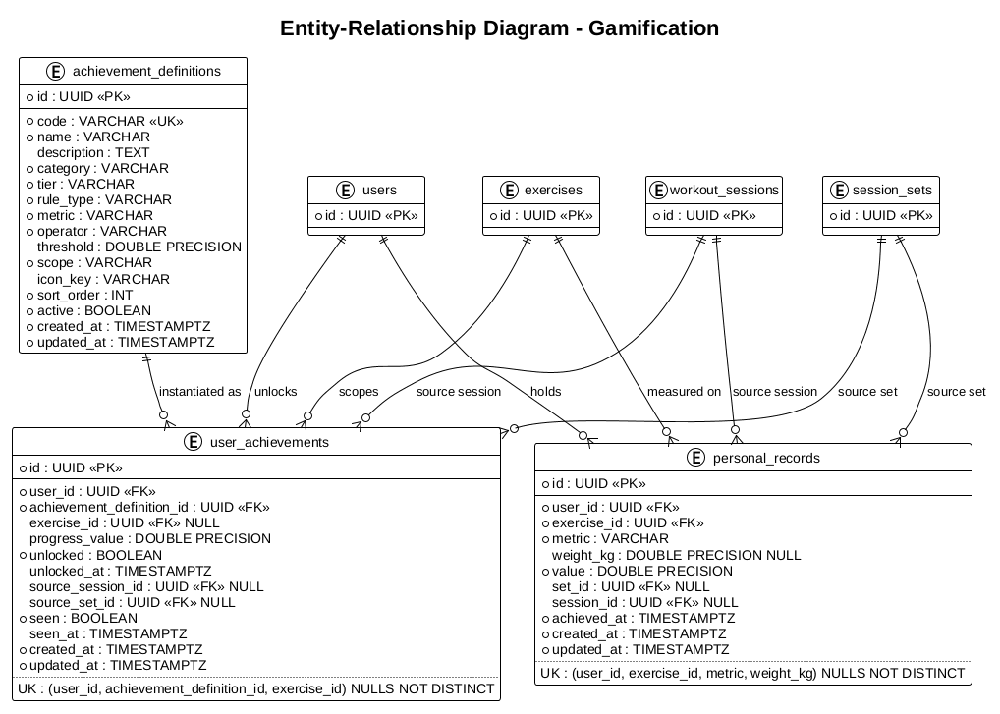

# Gamification Module

> **Proposed.** This module is not implemented yet. The table below describes the
> target state described in the [design document](design.md).

Owns workout achievements (badges): their catalog, the user's progress toward
them, the unlock events, and the in-app feed of newly earned badges.

Achievements are **persisted** rather than computed on every read. A read of the
catalog is a static lookup of rows; the expensive comparison against training
history happens when a workout session is completed or a set is marked as done.

## Documentation

- [Design: schema, flows, API and rollout](design.md)

The module keeps the separation of concerns already established in
[ADR-0009](../adr/0009-adopt-pragmatic-hexagonal-architecture.md):

- `stats` owns the training aggregates and exposes them through a port.
- `gamification` owns the achievement lifecycle and the personal-record state.
- `workout` triggers the evaluation through a port; it no longer calls `stats`.

## Entity-Relationship Diagram

