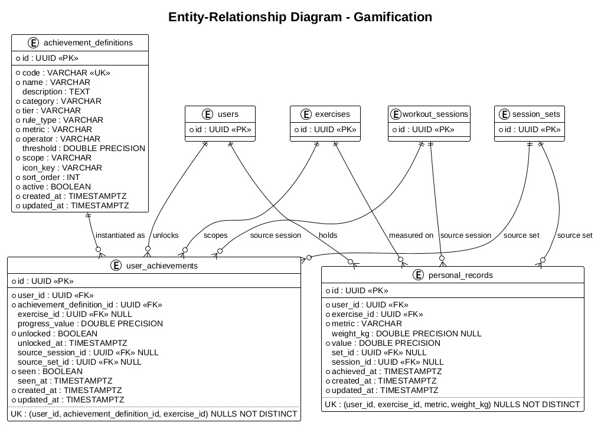

# Gamification Module

Owns the achievements (badges) a user can earn while training: the catalog of
available achievements, the progress the user reached in each one, the personal
records behind the record-based badges, and the in-app feed of recent unlocks.

Achievements are **persisted**, not computed on read. The evaluation runs when
the user trains, and every read is a lookup of already computed state.

## Documentation

- [Design: schema, flows, API and rollout](design.md)
- [API Reference](api.md)
- [Business Rules and Calculation Semantics](business-rules.md)
- [Frontend Integration](frontend.md)

## Module Boundaries

The module follows the pragmatic hexagonal boundaries of
[ADR-0009](../adr/0009-adopt-pragmatic-hexagonal-architecture.md).

- The `workout` module triggers the evaluation through `EvaluateAchievementsUseCase`
  when a session is completed, when a set is completed, and when a destructive
  operation invalidates a record.
- The `stats` module provides the training aggregates through
  `TrainingMetricsUseCase`.
- The `exercise` module provides the catalog entries for the names of the
  exercises an achievement is scoped to.
- The module reads the workout history with its own SQL instead of depending on
  the entities of the `workout` module, and refers to users, exercises,
  sessions, and sets by identifier.

## Data Model

| Table | Holds |
|---|---|
| `achievement_definitions` | The catalog: what achievements exist and under which rule |
| `user_achievements` | The state of a user per achievement and scope: progress, unlock, seen |
| `personal_records` | The best value the user reached per exercise, metric, and weight |

The schema is owned by the Flyway migrations, and Hibernate validates the entity
mapping against it instead of generating it.
